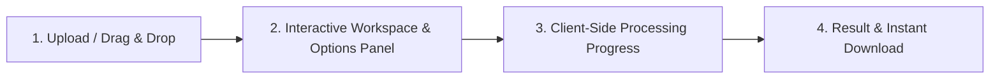

# Implementation Plan: PDFWave (Web-Based PDF Toolkit)

## 1. Project Naming & Brand Identity
We propose naming the toolkit **PDFWave** (harmonizing with the `HiddenWave` brand) or alternatively **DocCraft** / **OmniPDF**.
- **Primary Name Candidate:** **PDFWave** — *"Modern, fast, privacy-first PDF utility suite in your browser."*
- **Design Aesthetic:** Clean, premium, iLovePDF-inspired layout with vibrant accent gradients, high-contrast accessible typography (Inter / Outfit), responsive cards, micro-interactions, and clear visual state transitions.

---

## 2. Architecture & Monorepo Structure

The project will reside in `D:\HiddenWave\Projects\Pdf-Doc-Tool` with a decoupled frontend and backend architecture:

```
Pdf-Doc-Tool/
├── docker-compose.yml             # Orchestration for Frontend, Backend, Redis, Worker
├── README.md                      # Setup and usage guide
├── frontend/                      # React + Vite + TypeScript + Tailwind CSS
│   ├── package.json
│   ├── vite.config.ts
│   ├── tailwind.config.js
│   ├── tsconfig.json
│   ├── public/
│   │   └── pdf.worker.min.mjs     # pdfjs-dist web worker for thumbnail rendering
│   └── src/
│       ├── types/                 # Shared TypeScript interfaces
│       ├── registry/              # Tool registry definitions & category mapping
│       │   ├── categories.ts      # 7 core categories
│       │   ├── index.ts           # Central tool catalog & lookup
│       │   └── types.ts           # ToolMetadata & ToolModule interfaces
│       ├── components/
│       │   ├── layout/
│       │   │   ├── Header.tsx     # Brand bar + search + mega-menu trigger
│       │   │   ├── MegaMenu.tsx   # Multi-column dynamic category dropdown
│       │   │   └── Footer.tsx
│       │   ├── common/
│       │   │   ├── Dropzone.tsx   # Multi-file drag-and-drop uploader
│       │   │   ├── FileList.tsx   # Reorderable file queue with badge & delete
│       │   │   ├── PageGrid.tsx   # Thumbnail grid with drag reordering
│       │   │   └── ProgressBar.tsx
│       │   ├── shell/
│       │   │   └── ToolShell.tsx  # Universal 4-step wizard shell
│       ├── tools/                 # Tool-Registry directory pattern
│       │   ├── merge/
│       │   │   ├── metadata.ts
│       │   │   ├── logic.ts
│       │   │   ├── logic.test.ts
│       │   │   └── Component.tsx
│       │   ├── split/
│       │   ├── remove-pages/
│       │   ├── extract-pages/
│       │   ├── organize/
│       │   ├── rotate/
│       │   ├── page-numbers/
│       │   ├── watermark/
│       │   ├── jpg-to-pdf/
│       │   └── pdf-to-jpg/
│       ├── lib/                   # pdf-lib helpers, pdfjs renderers, zip utilities
│       │   ├── pdf-renderer.ts    # Canvas-based page thumbnail generator
│       │   ├── zip-utils.ts       # JSZip export helper
│       │   └── file-utils.ts      # Size formatters, download triggers
│       ├── pages/
│       │   ├── HomePage.tsx       # Hero, category tabs, dynamic tool grid
│       │   └── ToolPage.tsx       # Dynamic route handler mounting ToolShell
│       └── App.tsx                # App router and navigation
├── backend/                       # FastAPI scaffold (Phase 1 stub ready for future phases)
│   ├── Dockerfile
│   ├── requirements.txt
│   └── app/
│       ├── main.py                # Healthcheck & API routes
│       ├── core/config.py
│       └── workers/tasks.py       # RQ task queue stubs
└── tests/                         # Root test configs
```

---

## 3. Tool Registry Pattern

Every tool is self-contained in `src/tools/<id>/` and exports:
1. `metadata`: Defines metadata used to automatically populate the **MegaMenu**, **Homepage Grid**, **Breadcrumbs**, and **Route Matching**.
2. `Component`: Custom options panel & workspace canvas injected into `ToolShell`.
3. `logic`: Pure client-side processing functions utilizing `pdf-lib` and `pdfjs-dist`.

### Core Interfaces:
```typescript
export type ToolCategory =
  | 'Organize PDF'
  | 'Optimize PDF'
  | 'Convert to PDF'
  | 'Convert from PDF'
  | 'Edit PDF'
  | 'PDF Security'
  | 'PDF Intelligence';

export type ToolMode = 'client' | 'server';

export interface ToolMetadata {
  id: string;
  name: string;
  category: ToolCategory;
  description: string;
  iconName: string; // Lucide icon
  mode: ToolMode;
  badge?: 'Popular' | 'New' | 'Client-Side';
  acceptedTypes: string[]; // e.g. ['application/pdf'] or ['image/jpeg', 'image/png']
  allowMultiple: boolean;
  minFiles?: number;
  maxFiles?: number;
}
```

---

## 4. Shared `ToolShell` Workflow (iLovePDF Style)

The `ToolShell` provides a unified, zero-friction 4-step UX across all tools:



1. **Upload Stage:**
   - Huge intuitive dropzone with dashed border, icon, and prominent "Select PDF files" button.
   - Supports Drag-and-Drop, system file picker, and clipboard paste.
   - Validates file types and count against tool metadata.
2. **Workspace & Options Stage:**
   - **Left / Center Viewport:** Document page viewer, thumbnail grid, or reorderable file cards with drag handles.
   - **Right Sidebar (or Mobile Sticky Bottom):** Tool-specific parameter controls (e.g. margin, rotation angle, watermark text, page ranges).
   - Sticky primary call-to-action button (e.g. `Merge PDF →`, `Rotate Pages →`).
3. **Processing Stage:**
   - Deterministic progress bar with percentage, current operation status (`Rendering thumbnail 3 of 12...`, `Assembling pages...`), and cancel button.
   - 100% processed in the client’s browser using Web Workers / asynchronous chunks (preventing UI freeze).
4. **Download Stage:**
   - Success checkmark animation.
   - Large primary `Download Processed PDF` button.
   - File size comparison metric (e.g. "Input: 2.4 MB | Output: 1.8 MB").
   - Quick action to "Process another file" or "Continue editing with another tool".

---

## 5. Phase 1: 10 Client-Side Tools Specification

All client-side tools execute strictly in-memory without uploading any byte to a remote server.

| Tool ID | Tool Name | Category | Core Dependencies | Primary Options / Features |
| :--- | :--- | :--- | :--- | :--- |
| `merge-pdf` | **Merge PDF** | Organize PDF | `pdf-lib` | Reorder uploaded files, remove files, merge into single PDF |
| `split-pdf` | **Split PDF** | Organize PDF | `pdf-lib`, `jszip` | Split by custom range (e.g. `1-3, 5, 7-10`), or split each page into individual files (packaged into `.zip`) |
| `remove-pages` | **Remove Pages** | Organize PDF | `pdf-lib`, `pdfjs-dist` | Visual page thumbnail grid; click to select/deselect pages for deletion; live remaining page count |
| `extract-pages` | **Extract Pages** | Organize PDF | `pdf-lib`, `pdfjs-dist`, `jszip` | Visual thumbnail selector or comma-separated range input; extract to 1 merged PDF or separate ZIP files |
| `organize-pdf` | **Organize PDF** | Organize PDF | `pdf-lib`, `pdfjs-dist` | Full drag-and-drop page reordering, individual page rotation, page duplication, and deletion |
| `rotate-pdf` | **Rotate PDF** | Edit PDF | `pdf-lib`, `pdfjs-dist` | Rotate all pages or specific pages (90°, 180°, 270° clockwise / counter-clockwise); visual live rotation preview |
| `page-numbers` | **Page Numbers** | Edit PDF | `pdf-lib` | Position (6 anchors: top/bottom x left/center/right), format (`Page X`, `X of Y`, `X`), margin, font size, start number |
| `watermark` | **Add Watermark** | Edit PDF | `pdf-lib` | Text watermark: text value, opacity, rotation angle (-45° to 45°), position, font size, color, layer (above/below content) |
| `jpg-to-pdf` | **JPG to PDF** | Convert to PDF | `pdf-lib` | Accepts JPG/PNG; drag to order; orientation (Portrait/Landscape/Auto); margin (None/Small/Big); page size (Fit image / A4 / Letter) |
| `pdf-to-jpg` | **PDF to JPG** | Convert from PDF | `pdfjs-dist`, `jszip` | Render PDF pages to canvas at 150/300 DPI, export to JPG/PNG; single page downloads image, multiple pages download as ZIP |

---

## 6. Backend & Infrastructure (Phase 1 Baseline)

While the Phase 1 tools operate 100% on the client side, the project scaffolding includes the backend infrastructure ready for Phase 2/3 (server-side conversions, OCR, compression):
- **FastAPI:** Health check endpoint (`/api/health`), CORS configuration allowing local dev, and API router skeleton.
- **Redis & RQ Worker:** Containerized Redis and worker daemon configured for async job processing.
- **Docker Compose:** Multi-stage setup running `frontend` (Vite dev/nginx), `backend` (FastAPI/uvicorn), `redis`, and `worker`.

---

## 7. Testing Strategy

1. **Unit Tests (`vitest`):**
   - Pure logic tests for each of the 10 tools in `src/tools/<id>/logic.test.ts`.
   - Uses synthesized PDF buffers created via `pdf-lib` to assert:
     - Merging 2 documents with $N$ and $M$ pages results in $N+M$ pages.
     - Splitting returns the exact requested page subsets.
     - Rotation modifies the `/Rotate` attribute of target pages.
     - Image conversion produces valid PDF byte stream with proper embedded dimensions.
     - Page number text drawing executes without buffer corruption.
2. **Browser Validation:**
   - Responsive design verification across mobile, tablet, and desktop viewports.
   - Verification that drag-and-drop file upload and thumbnail reordering operate smoothly.

---

## 8. Implementation Steps & Milestones

1. **Milestone 1 — Scaffolding & Setup:**
   - Initialize Vite + React + TypeScript + Tailwind CSS in `frontend/`.
   - Install dependencies: `pdf-lib`, `pdfjs-dist`, `jszip`, `lucide-react`, `vitest`.
   - Set up Docker Compose, FastAPI backend stub, and Redis/RQ configuration.
2. **Milestone 2 — Tool Registry, MegaMenu & Homepage:**
   - Create registry types, category mappings, and the 7 categories.
   - Build responsive Header with brand logo, quick search, and Category Mega-Menu.
   - Build Homepage with hero banner, category pills/tabs, and dynamic grid of tool cards.
3. **Milestone 3 — Shared ToolShell & File/Page Utilities:**
   - Implement `Dropzone` with drag-over animations and validation.
   - Implement `ToolShell` state machine (Upload $\to$ Workspace $\to$ Processing $\to$ Result).
   - Implement PDF thumbnail renderer via `pdfjs-dist` canvas worker.
4. **Milestone 4 — Core Client Tools (Organize & Edit):**
   - Implement `Merge`, `Split`, `Remove Pages`, `Extract Pages`, `Organize`, and `Rotate`.
   - Build visual thumbnail grid with page selection and reordering.
5. **Milestone 5 — Content & Conversion Tools:**
   - Implement `Page Numbers`, `Watermark`, `JPG to PDF`, and `PDF to JPG`.
   - Implement zip packaging with `JSZip` for multi-file downloads.
6. **Milestone 6 — Testing, Documentation & Polish:**
   - Write comprehensive unit tests for all 10 tools' core logic.
   - Create `README.md` with complete installation, local run, and Docker Compose commands.
   - Perform polish pass on typography, hover effects, dark/light contrast, and accessibility.
